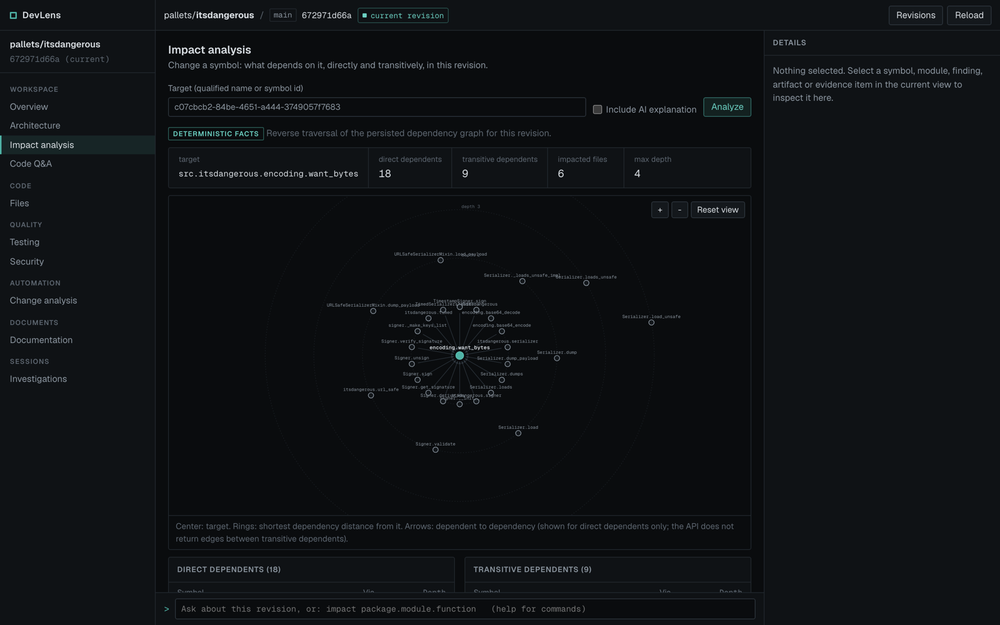
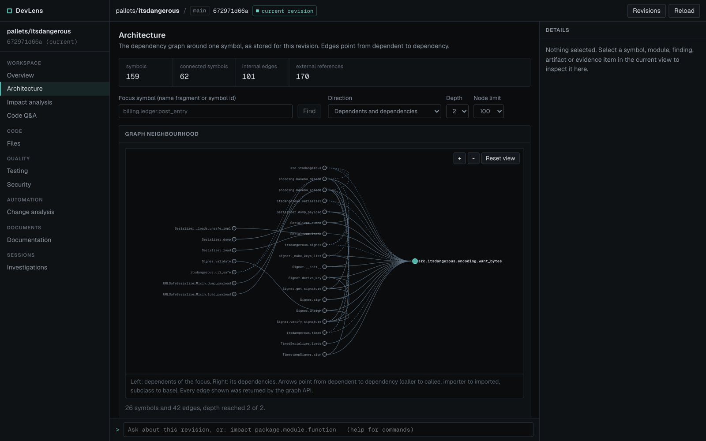
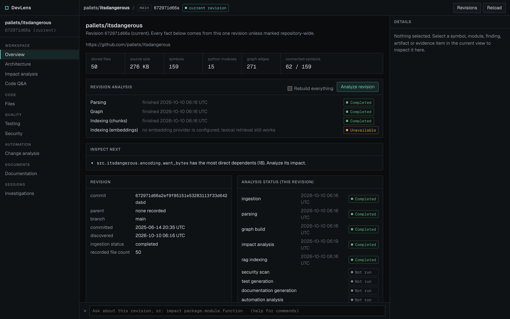

# DevLens

**Understand your code before you change it.**

DevLens is a codebase intelligence platform. It ingests a Git repository at a
specific commit, parses it into symbols, builds a dependency graph, and answers
the question a developer actually has before a change: *what does this touch?*
Deterministic analysis establishes the facts; an optional language model only
explains facts that analysis has already established.

---

## What it does

- **Maps a repository.** Every Python file of one revision becomes symbols
  (modules, classes, functions, methods) and directed edges between them
  (calls, imports, inheritance).
- **Computes change impact.** Pick a symbol; DevLens walks the graph backwards
  and returns every dependent with its shortest distance, the relationship
  types that connect it, and the files involved. No model is involved.
- **Explains, cites, and stops there.** When an AI provider is configured,
  impact results, code questions, documentation and security findings can be
  explained in prose. The model only sees numbered evidence DevLens retrieved,
  every citation is checked against that evidence, and anything the model
  cannot ground is stripped or rejected.
- **Connects quality signals to the same graph.** Test discovery and
  generation, OSV-Scanner and Semgrep findings with graph blast radius,
  revision-to-revision change analysis, generated documentation, and saved
  investigation sessions all read the same revision-scoped graph.

## Why DevLens

Most "chat with your code" tools retrieve text chunks and ask a model to
reason about them. That has two failure modes for change analysis: the model
can invent relationships that are not in the code, and retrieval can miss the
callers that matter because they do not look textually similar.

| | Generic code chat | Retrieval-only | DevLens |
|---|---|---|---|
| Source of "who depends on X" | model's guess | text similarity | graph traversal |
| Same input, same answer | no | mostly | yes |
| Callers that share no words with X | often missed | often missed | found by edges |
| What the model may add | anything | anything | prose over cited evidence |
| Works with no model configured | no | partially | yes; AI is optional |

**Change impact is the core.** Graph edges always point from the dependent to
its dependency (`refund -> post_entry` means "refund calls post_entry"). Impact
analysis is a reverse traversal from the changed symbol: depth 1 are direct
callers, importers and subclasses; depth 2 are their dependents; and so on,
each reported at its shortest depth, cycle-safe and bounded. The same revision
and symbol always produce the same impacted set. An AI explanation, if
requested, is layered on top and cannot add, remove or re-rank impacted
symbols: its response schema has no field for them.

## Screenshots

Real captures of the workstation analyzing the public
[pallets/itsdangerous](https://github.com/pallets/itsdangerous) repository at
commit `672971d66a`, with no AI provider configured: everything shown is
deterministic.

**Impact analysis.** Changing `encoding.want_bytes` reaches 18 direct and 9
transitive dependents across 6 files, up to 4 hops away; rings are shortest
dependency distance.



**Architecture.** The stored graph neighbourhood of the same symbol:
dependents on the left, dependencies on the right, every edge pointing from
dependent to dependency.



**Revision overview.** Per-revision facts and the real status of every
analysis stage, including stages that are unavailable or have not run.



## Core architecture

```
 GitHub URL (https, github.com only)
      |
      v
 Repository --> Revision (one commit; immutable)
                   |
                   v
             Source files (content-addressed blobs)
                   |
                   v
             Python AST  -->  Symbols  (revision-scoped, stable ids across re-parses)
                                 |
                                 v
                        Dependency graph  (calls / imports / inherits; dependent -> dependency)
                                 |
            +--------------------+---------------------+---------------------------+
            v                    v                     v                           v
     Impact analysis      Code chunks + index     Security findings          Test discovery
     (reverse traversal)  (lexical + pgvector)    (OSV-Scanner, Semgrep)     and generation
            |                    |                 + graph blast radius            |
            v                    v                     |                           v
     Evidence assembly:  numbered, bounded source excerpts and graph facts  (E1, Q1, D1, T1 ...)
                                 |
                                 v
            Optional AI explanation  (structured output, schema-validated, citations checked)
                                 |
                                 v
     Persisted results:  AnalysisRuns, generated tests, documentation, findings, sessions
```

Around that core:

- **Analysis pipeline** (`POST .../revisions/{id}/analyze`) runs parsing, graph
  construction, chunking and (when configured) embedding as revision-scoped
  rebuilds, reuses stages that are already current, and serializes rebuilds of
  one revision with a PostgreSQL advisory lock.
- **Automation** compares a revision with its real Git parent: file delta,
  symbol delta, impact of every changed symbol, and which tests, chunks and
  security results the change invalidates.
- **Documentation** generates repository, architecture, module and symbol
  documentation from the same bounded evidence, with a deterministic fallback.
- **Investigation sessions** keep the developer's thread: messages plus typed
  references to the symbols, files, runs and findings they looked at.
- **Repository overview** is a read-only aggregation of everything above for
  one revision.

## Engineering principles

These are enforced in code and covered by tests, not aspirations.

- **Deterministic facts before AI.** Every AI feature works without a
  provider: impact returns its deterministic result, Q&A returns the retrieved
  evidence, documentation falls back to a deterministic draft, and test
  generation reports `no_provider` instead of producing anything. A provider
  timeout, HTTP error, or malformed or schema-violating response never
  replaces a deterministic result.
- **Fail-closed model output.** Responses are parsed into Pydantic models with
  `extra="forbid"`; a smuggled field (an extra impact node, a risk score) fails
  validation. Citations are checked against the supplied evidence ids; unknown
  ids are replaced with `[unverified]` or dropped.
- **Untrusted repository content.** Source text, READMEs and comments only ever
  appear inside a delimited "untrusted evidence" section of the user message;
  system prompts never contain repository text.
- **Graph direction is an invariant.** `source = dependent`,
  `target = dependency`, everywhere: storage, traversal, API and UI.
  References that cannot be resolved are reported as external or unresolved,
  never guessed.
- **Revision isolation in the schema.** Every derived table carries
  `(repository_id, revision_id)`; composite foreign keys tie symbols to files
  and edges to symbols *of the same revision*, so cross-revision rows cannot
  exist. Queries filter on both.
- **Idempotent, rebuildable derived state.** Analysis stages rebuild a
  revision's derived rows deterministically; re-parsing keeps the id of every
  symbol it reproduces, so references held by sessions, tests and docs stay
  valid. Upserts target partial unique indexes; `AnalysisRun` keeps an
  append-only history.
- **Provenance.** Generated tests and documentation record which provider and
  model produced them; unknown provenance is `NULL`, never an empty string.
- **Bounded everything.** Graph depth and node limits, source windows,
  evidence budgets, page sizes and ingestion limits are explicit constants,
  enforced at the API boundary.
- **Honest failure.** A security scanner that is not installed is reported as
  `unavailable`, never as clean, and a scan in which no scanner completed is
  recorded as `failed`. Analysis stages report `not_run` and `unavailable`
  rather than zero.

## Capabilities

**Repository ingestion** (`app/ingestion`). Public HTTPS `github.com` URLs
only; credentials, IP literals, query strings and other hosts are rejected.
Shallow, single-branch clone with no tags, submodules or LFS, a credential-free
git environment, timeouts on every git call, path-escape checks, and limits on
file count, file size and total bytes. File contents are stored once,
content-addressed.

**Code intelligence** (`app/parsing`, `app/graph`, `app/codeintel`). Python
AST parsing into revision-scoped symbols with qualified names, line spans and
signatures; syntax errors are isolated per file. Graph construction resolves
imports, calls and base classes against the revision's own symbol table. Read
APIs for files, bounded source windows, symbol search and graph neighborhoods.

**Impact analysis** (`app/impact`). Reverse breadth-first traversal with
shortest depths, cycle safety and node limits; impacted files grouped by
minimum depth. Optional AI explanation over numbered evidence (`E1`, `E2`, ...)
with a versioned prompt in `docs/prompts/`.

**Codebase Q&A** (`app/rag`). Symbol-aware chunks; lexical retrieval with
PostgreSQL full-text search (operator-free `plainto_tsquery`), optional vector
retrieval with pgvector, combined by Reciprocal Rank Fusion, then expanded
along graph edges. Answers cite `Q` evidence ids; without a provider the API
returns the retrieved evidence only.

**Testing intelligence** (`app/testing`). Finds existing tests through call and
import evidence (pytest functions and methods, `unittest.TestCase` methods),
never by file name alone. Generates a test for a target from bounded evidence,
validates its path and syntax, optionally executes it in a subprocess with a
timeout, and persists the execution result with provider and model provenance.

**Security intelligence** (`app/security`). Runs OSV-Scanner on dependency
manifests and Semgrep on Python source when the binaries are installed,
normalizes findings with deterministic fingerprints, records per-revision
observations, resolves them to symbols, and computes a bounded graph blast
radius that is reported separately from scanner severity. No risk score is
computed.

**Automation** (`app/automation`). Resolves the revision's actual Git parent
(never "the previous revision"), computes file and symbol deltas, reuses
impact analysis for changed symbols, rebuilds chunks, and identifies stale
generated tests and needed security re-runs. Exactly one run row per
(revision, parent) identity, with concurrent requests rejected by the rebuild
lock.

**Documentation intelligence** (`app/documentation`). Repository overview,
architecture overview, module and symbol documentation with `D` evidence
citations, a deterministic fallback, and idempotent persistence per
(revision, artifact type, target).

**Investigation sessions** (`app/investigation`). Repository-scoped sessions
with ordered messages, recents, revision switching, and typed context
references (symbol, file, analysis run, finding, graph focus) that remain
valid historical breadcrumbs across revisions and re-parses.

**Workstation UI** (`apps/web`). A Next.js workstation over the API: overview,
architecture graph, files and source, impact, Q&A, testing, security, change
analysis, documentation and investigations, with a revision switcher and a
command bar. Page loads never trigger analysis or AI calls; those run only on
an explicit action. The landing page at `/` renders DevLens's own backend graph
(exported from a DevLens analysis of `apps/api/app`) in WebGL with Three.js,
with a static fallback for reduced motion.

## Repository structure

```
apps/
  api/                    FastAPI backend (Python 3.12, uv)
    app/
      ingestion/          URL policy, git adapter, checkout, file walk
      parsing/            Python AST parser and symbol persistence
      graph/              import/call/inheritance resolution, edge persistence
      codeintel/          read APIs: files, source windows, symbols, neighborhoods
      impact/             reverse traversal, evidence, optional explanation
      rag/                chunking, lexical/vector/hybrid retrieval, Q&A
      testing/            test discovery, generation, validation, execution
      security/           OSV-Scanner, Semgrep, findings, blast radius
      automation/         revision deltas and invalidation planning
      documentation/      evidence-bound documentation generation
      investigation/      sessions, messages, context references
      overview/           read-only per-revision aggregation
      pipeline/           analysis orchestration and stage status
      ai/                 provider protocol, Anthropic and OpenAI clients
      models/ db/ core/   SQLAlchemy models, sessions and locks, settings
      api/routes/         thin HTTP layer over the services
    alembic/              schema migrations
    tests/                pytest suites per subsystem
  web/                    Next.js 16 / React 19 workstation and landing page
    src/app/              routes: /, /workspace, /repositories/[id]/...
    src/components/       workstation views, graph rendering, landing scenes
    src/lib/api/          typed API client
infra/                    Docker Compose: PostgreSQL 17 with pgvector (and Redis)
docs/architecture/        per-subsystem design records
docs/prompts/             versioned LLM prompts
```

## Reliability and security

- **Ingestion** is the only network-facing input: strict URL policy, a
  hardened and time-limited git invocation, and size limits (see
  `docs/architecture/repository-ingestion.md`).
- **Prompt injection.** Repository text is data, delimited and labelled as
  untrusted; model output is schema-validated and citation-checked; tests feed
  hostile READMEs, fake system messages and fake evidence ids through each AI
  path (impact, Q&A, documentation, security, test generation).
- **Input validation.** UUIDs are validated at the route boundary, bounded
  query parameters are enforced by FastAPI, and NUL characters in session text
  and JSON are rejected before any database work.
- **No secrets in results.** API keys are only sent to the configured
  provider; tests assert they do not leak into provider errors, persisted rows
  or API responses.
- **Concurrency.** Per-revision advisory locks serialize rebuilds; message
  sequence numbers are allocated under a row lock; idempotent upserts back the
  "same request twice" cases.
- **Generated-test execution** runs in a disposable directory with a minimal,
  credential-free environment, `shell=False`, a timeout and output caps. It
  is **not** an OS-level sandbox: there is no container, network or filesystem
  isolation (see `app/testing/sandbox.py`).

## Running locally

Prerequisites: Node.js 24 and pnpm, Python 3.12 and
[uv](https://docs.astral.sh/uv/), Docker, and `git` on the PATH.

```bash
cp apps/web/.env.example apps/web/.env.local
cp apps/api/.env.example apps/api/.env
cp infra/.env.example infra/.env

make infra-up                              # PostgreSQL 17 + pgvector (and Redis)
cd apps/api && uv sync && cd ../..
make migrate                               # alembic upgrade head
make dev-api                               # http://localhost:8000
cd apps/web && pnpm install && cd ../..
make dev-web                               # http://localhost:3000
```

Optional, each enabling one layer without affecting the deterministic core:

| Setting / tool | Enables |
|---|---|
| `AI_API_KEY` (Anthropic) | impact, Q&A, documentation and security explanations; test generation |
| `EMBEDDING_API_KEY` (OpenAI) | vector and hybrid retrieval (lexical retrieval works without it) |
| `osv-scanner`, `semgrep` on the PATH | dependency and static-analysis findings (otherwise reported as unavailable) |

## Testing

```bash
make test    # backend pytest + frontend vitest + frontend typecheck
make lint    # ruff, ruff format --check, mypy; eslint, prettier --check
cd apps/web && pnpm build
```

- **Backend:** pytest suites per subsystem. Database tests run against a real
  PostgreSQL with pgvector (they exercise real constraints, partial indexes,
  advisory locks and concurrency) and skip with a clear reason if the
  database is unreachable. No test calls a real LLM; providers are faked or
  `httpx` is monkeypatched.
- **Frontend:** Vitest and Testing Library for views, the API client, the
  workstation and the landing page, plus `tsc` and ESLint.
- **Schema:** a static test keeps Alembic migrations and SQLAlchemy models in
  constraint-name parity.

## Demo

1. Open `http://localhost:3000`, choose **Explore DevLens**, and ingest a small
   public Python repository from GitHub.
2. Press **Analyze revision**, then **Open workstation**: the overview shows
   files, symbols, graph statistics and every stage's real status.
3. **Architecture**: open a symbol (from the overview's ranked lists or the
   command bar) and switch between dependents and dependencies; the rendered
   edges are exactly the API's edges.
4. **Impact analysis**: analyze that symbol to get its dependents by depth and
   the impacted files. With an AI key, tick **Include AI explanation** to see
   prose that cites the deterministic evidence.
5. **Code Q&A**: ask a question; the evidence list shows each excerpt's
   retrieval source (lexical, vector, graph) and the answer's citations.
6. **Testing** and **Security**: generate a test for a target (AI key
   required) and run a security analysis (installed scanners required;
   otherwise both are shown as unavailable).
7. **Investigations**: use **Save to investigation** from any selection, then
   resume the session later from the sidebar. **Change analysis** compares a
   revision with its parent once the repository has been ingested at two
   commits.

## Known limitations

- **Python only.** The parser and graph cover Python; other files are stored
  but not analyzed.
- **Static resolution.** Dynamic dispatch, attribute calls on modules and
  runtime-constructed names are not resolved; they are reported as
  unresolved or external rather than guessed.
- **Public GitHub only**, at the default branch's head, with no authentication,
  users or multi-tenancy: DevLens is a single-user local tool.
- **Synchronous analysis.** Pipeline stages run inside the request; there is no
  job queue, and every stage is a full-revision rebuild (no incremental
  parsing).
- **Not bundled:** OSV-Scanner and Semgrep must be installed separately;
  generated tests execute without OS-level isolation.
- **Provider choice:** Anthropic for generation and OpenAI for embeddings; the
  suite never calls either for real.
- **Partial scanner runs:** per-scanner status is returned in the response but
  not persisted, so a stored scan where one scanner was unavailable still reads
  as completed.
- **Redis** is provisioned by Compose but not used by the application.

## Why this is technically interesting

The hard part of DevLens is not calling a model; it is making the facts the
model sees trustworthy. That means a revision-scoped data model where
cross-revision references are impossible by construction, a graph with a single
direction invariant that every layer respects, symbol identity that survives
re-analysis so history stays valid, retrieval that combines lexical, vector and
graph signals deterministically, and an AI boundary that treats both repository
content and model output as untrusted: evidence goes in numbered and delimited,
output comes back schema-checked and citation-checked, and every AI feature
degrades to a correct deterministic answer when the model is absent or wrong.

Design records for each subsystem are in
[`docs/architecture/`](docs/architecture/): start with
[`domain-model.md`](docs/architecture/domain-model.md),
[`analysis-pipeline.md`](docs/architecture/analysis-pipeline.md) and
[`impact-analysis.md`](docs/architecture/impact-analysis.md).
