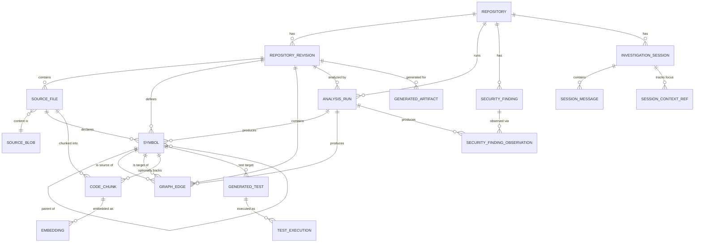

# DevLens Domain Model

Status: **design only**. Nothing in this document is implemented. No migrations, ORM
models, or tables exist yet. This document exists so that implementation (next step)
has an architecture to build instead of inventing one file-by-file.

## 0. Three kinds of state

DevLens's data falls into three categories that must never be collapsed into one
generic table:

1. **Source truth** — what actually exists in the repository (owner/name, commits,
   file paths, file content). DevLens does not infer this; it observes it from Git/GitHub.
2. **Derived analysis** — what DevLens *inferred* from source truth (symbols, graph
   edges, embeddings, security findings, generated docs/tests). Always produced by,
   and traceable to, an `AnalysisRun`.
3. **Investigation state** — what a developer (or the AI, on their behalf) asked,
   selected, or focused on. Not a fact about the code; a fact about a conversation.

Every entity below is tagged with which of the three it belongs to.

## Conventions used throughout

- **Primary keys**: UUID, except `SourceBlob` (content-hash is the natural key) and
  join/log tables with their own composite identity.
- **Timestamps**: `timestamptz`, UTC.
- **`status` / `kind` / `relationship_type` / `analysis_type` columns**: plain text
  with an application-level allow-list (and a `CHECK` constraint once implemented),
  **not** native Postgres `ENUM` types. Native enums require `ALTER TYPE ... ADD VALUE`
  (awkward inside transactions, easy to forget) every time a new analyzer or symbol
  kind is added — and this system will add analyzer types and symbol kinds constantly.
  Text + CHECK gets the same validation with a one-line migration to extend.
- **`repository_id` is denormalized onto almost every table**, even though it's always
  reachable via `revision_id → repository_id`. This is deliberate: it avoids a join for
  the single most common query shape ("everything for repo X") and keeps the door open
  for partitioning large tables by `repository_id` later. It is a read-optimization,
  not a second source of truth — it must always equal `revision.repository_id` and
  should be set by a trigger or application-layer invariant, not independently editable.

---

## 1–2. Repository and RepositoryRevision

**Category: source truth.**

The key design question is what belongs on `Repository` (one row per tracked GitHub
repo, ever) versus `RepositoryRevision` (one row per commit DevLens has looked at).
The rule: **`Repository` holds identity and a pointer to current state. It holds no
analysis-shaped data itself.** Anything that could differ commit-to-commit belongs on
`RepositoryRevision`, never duplicated onto `Repository`.

### Repository

| Field | Type | Notes |
|---|---|---|
| `id` | uuid pk | |
| `owner`, `name` | text | unique together — GitHub identity |
| `url` | text | clone URL |
| `default_branch` | text | from GitHub, mutable (someone can change it upstream) |
| `current_revision_id` | uuid, FK → RepositoryRevision, nullable | the one pointer field that legitimately mutates on `Repository` — "what we currently show by default" |
| `status` | text | `pending \| ingesting \| ready \| error \| archived` — **denormalized cache**, see §12 |
| `last_successful_analysis_at` | timestamptz, nullable | denormalized cache, same caveat |
| `created_at`, `updated_at` | timestamptz | |

Note what is deliberately **not** here: no file counts, no language breakdown, no
"last commit message" — those are facts about a *revision*, and putting them on
`Repository` would mean every new commit silently overwrites history that the
immutability requirement (§13) says must be preserved.

### RepositoryRevision

| Field | Type | Notes |
|---|---|---|
| `id` | uuid pk | |
| `repository_id` | uuid FK | |
| `commit_sha` | text | unique with `repository_id` |
| `parent_sha` | text, nullable | informational string, not an FK (see §16 on merge topology) |
| `branch_ref` | text, nullable | the ref DevLens discovered this commit on — informational only; a commit can live on many branches, so this is not identity |
| `author_name`, `author_email` | text, nullable | display metadata |
| `committed_at` | timestamptz | from Git |
| `discovered_at` | timestamptz | when DevLens first recorded this revision (may lag `committed_at`) |
| `latest_analysis_status` | text, nullable | **denormalized cache** rolled up from `AnalysisRun` rows for this revision, see §12 |
| `file_count` | int, nullable | denormalized convenience |

`RepositoryRevision` deliberately does **not** duplicate `Repository.owner/name/url` —
those are reached via `repository_id`. It also does not have its own generic
"ingestion status" field distinct from `AnalysisRun`: ingestion is modeled as an
`AnalysisRun` of `analysis_type = 'ingestion'` like every other analyzer (§6), so there
is exactly one mechanism for "is X done for this revision," not two.

---

## 3. SourceFile and SourceBlob

**Category: source truth**, with one lightweight derived field (`parsing_status`,
called out explicitly below).

The question posed was whether files should be mutable records or revision-scoped
snapshots. **They are immutable, revision-scoped snapshot rows, backed by a separate
content-addressed blob table.** Two tables, not one, because they answer different
questions:

- **`SourceFile`** answers "what files existed, at what paths, in this revision" —
  this is cheap, revision-scoped identity.
- **`SourceBlob`** answers "what is the actual text" — this is content-addressed
  (keyed by content hash, e.g. the Git blob SHA) and is **not** revision-scoped,
  because the same byte-identical file content routinely recurs across revisions
  (a commit that touches one file leaves every other file's blob unchanged) and even
  across repositories (shared boilerplate, generated lockfiles, vendored code).

This split is what makes "reuse unchanged files across revisions" answerable without
contradiction: ingesting revision N+1 creates new `SourceFile` rows for every path
(because revision identity matters, §13), but when a path's content hash matches what
it was in revision N, the new `SourceFile` row simply points at the *same* `SourceBlob`
— no duplicate text storage, and (per §15) the parser can skip re-parsing that content
entirely.

### SourceBlob

| Field | Type | Notes |
|---|---|---|
| `content_hash` | text, **pk** | e.g. the Git blob SHA — content IS the identity |
| `storage_ref` | text | either the literal content (small files) or a pointer to object storage (large files) — threshold not decided, see §16 |
| `size_bytes` | int | |
| `created_at` | timestamptz | first time this content was seen, by any repo/revision |

### SourceFile

| Field | Type | Notes |
|---|---|---|
| `id` | uuid pk | |
| `repository_id` | uuid | denormalized |
| `revision_id` | uuid FK | |
| `path` | text | relative to repo root; unique with `revision_id` |
| `content_hash` | text FK → SourceBlob | |
| `language` | text, nullable | detected by extension/heuristic at ingestion time — a *light* inference, not full parsing; still grouped with source truth because it's needed just to route to the right parser, not a conclusion about the code |
| `size_bytes` | int | |
| `line_count` | int, nullable | filled in once computed |
| `is_binary` | bool | excludes the file from parsing/chunking |
| `parsing_status` | text | `pending \| parsed \| skipped \| failed` — **this one field is a derived cache**, not source truth: it is a read-optimization answering "does this file still need parsing," reconstructable by checking whether a successful parsing `AnalysisRun` produced `Symbol` rows for this file |
| `created_at` | timestamptz | |

---

## 4. Symbol

**Category: derived analysis.**

| Field | Type | Notes |
|---|---|---|
| `id` | uuid pk | |
| `repository_id` | uuid | denormalized |
| `revision_id` | uuid FK | **symbols are always revision-scoped** (§13) |
| `file_id` | uuid FK → SourceFile | |
| `analysis_run_id` | uuid FK → AnalysisRun | which parse produced this row — direct traceability |
| `kind` | text | `function \| method \| class \| interface \| type_alias \| module \| variable \| constant \| enum \| ...` — open-ended on purpose |
| `name` | text | simple identifier |
| `qualified_name` | text | e.g. `payments.Invoice.total` — used for search and cross-file resolution |
| `signature` | text, nullable | free text, language-specific; not every language/parser can produce one |
| `start_line`, `end_line` | int | |
| `start_column`, `end_column` | int, nullable | not every parser gives columns |
| `parent_symbol_id` | uuid FK → Symbol, nullable | e.g. a method's parent class — this *is* how containment is modeled for symbols, see §5 on why there's no separate "contains" edge for this case |
| `visibility` | text, nullable | public/private/exported where the language has the concept |
| `analyzer` | text | e.g. `tree-sitter-python@0.21`, `ts-morph@23` — see architecture note below |

A deliberate omission: there is **no** attempt to give a `Symbol` a stable identity
*across* revisions (e.g. "this is the same function as in the last commit, just
renamed"). Each revision's symbols are independent rows. Whether DevLens needs
cross-revision symbol identity for a "history of this function" feature is an open
question (§16), not a decision made here.

Not all languages or analyzers produce equally rich facts — a heuristic
tree-sitter-only pass may give `kind`/`name`/location with no `signature` and no
reliable `qualified_name` for dynamic dispatch, while a semantic pass (e.g. the TS
compiler API via ts-morph) can give much more. `analyzer` records which one produced
a given row so confidence can be judged per-symbol, not just per-language.

---

## 5. GraphEdge — the canonical graph model

**Category: derived analysis.** This is the most consequential design decision in the
document, because impact analysis, visualization, and RAG context-expansion all read
through it.

### The invariant

> **Edges point from the thing that depends, to the thing it depends on.**
> `source` = caller / importer / subtype / referrer.
> `target` = callee / imported / supertype / referent.

```
function A calls function B         →  edge(source=A, target=B)
module X imports module Y           →  edge(source=X, target=Y)
class Dog extends class Animal      →  edge(source=Dog, target=Animal)
```

**Impact analysis is backward traversal.** "What breaks if I change B" means: find
every edge where `target = B`, follow to its `source`, and repeat transitively. This
walks the *dependents* of B. "What does A depend on" is forward traversal from
`source = A` to `target`. These are genuinely different queries and need different
indexes (§14) — this is not a detail to defer.

### Edge table

| Field | Type | Notes |
|---|---|---|
| `id` | uuid pk | |
| `repository_id` | uuid | denormalized |
| `revision_id` | uuid FK | edges are revision-scoped, same reasoning as Symbol (§13) |
| `analysis_run_id` | uuid FK → AnalysisRun | |
| `relationship_type` | text | `imports \| calls \| inherits \| implements \| references \| contains \| ...` |
| `source_symbol_id` | uuid FK → Symbol | the dependent |
| `target_symbol_id` | uuid FK → Symbol, **nullable** | the dependency — **nullable because resolution can fail** |
| `target_external_ref` | text, nullable | populated when `target_symbol_id` is null: e.g. `"numpy.array"` for a call into code DevLens doesn't have a symbol for. Without this, unresolved external calls would simply vanish from the graph instead of showing up as "depends on something external." |
| `confidence` | real, 0.0–1.0, **nullable** | **`NULL` means "not calibrated."** No v1 analyzer emits a numeric score — see `graph-construction.md` section 7. A future analyzer with an actual calibration model (e.g. validated against a labeled dataset) may populate a real value here; until one exists, a numeric value must never be written, and `NULL` must never be read as "zero confidence." The proof that a `GraphEdge` is correct is never this column — it's row existence plus `target_symbol_id`/`target_external_ref` (§ above). |
| `resolution_method` | text | Three allowed values, each naming a genuinely different analysis technique: `syntactic` (tree-sitter/pattern matching — not yet implemented), `ast_resolution` (deterministic AST-based scope/import/binding resolution, no type inference — what the v1 Python graph builder actually does), `semantic` (type-checker-backed resolution — not yet implemented). This three-way split exists because `ast_resolution` is neither naive pattern matching nor type-checker-backed inference, and conflating it with either would misstate what was actually done — directly surfaces the accuracy risk flagged in the Phase-0 architecture review. |
| `evidence_file_id` | uuid FK → SourceFile | where the call/import site is — may differ from `source_symbol`'s own definition location (a call deep inside a function body) |
| `evidence_start_line`, `evidence_end_line` | int, nullable | |

**Why `contains` exists as a relationship type but is rarely used**: containment of a
method inside a class, or a symbol inside a file, is already captured by
`Symbol.parent_symbol_id` and `Symbol.file_id` — adding a redundant edge for that would
just be the same fact stored twice. `contains` is reserved for structural relationships
*not* otherwise captured by those FKs (e.g. package/directory containment above the
symbol level, where there is no parent-symbol chain).

### How traversal actually works (no graph database)

Postgres remains the only store. For small/ad-hoc queries (a handful of hops), a
recursive CTE over `graph_edge` is enough. For anything interactive — the graph
visualization UI, iterative impact analysis, RAG's graph-expansion step — the plan is
to load the relevant revision's edge set (or a bounded neighborhood of it) into an
in-memory graph structure in the Python backend (adjacency lists, or `networkx` /
`rustworkx` for anything performance-sensitive) and run BFS/DFS there. That in-memory
structure is a **rebuildable cache keyed by `revision_id`**, never a second source of
truth — if it's lost, it is reconstructed by re-querying `graph_edge`, never backfilled
by hand. This was the explicit reason Neo4j was rejected in the original architecture
review: Postgres is durable storage, the in-process graph is a derived, disposable
index over it.

---

## 6. AnalysisRun

**Category: the connective tissue between source truth and derived analysis** — not
itself source truth or a derived *result*, but the record of the process that produced
derived results.

One generic table serves every analyzer (ingestion, parsing, graph-build, impact
analysis, RAG indexing, security scanning, test generation, documentation generation),
rather than a near-identical `IngestionRun`/`ParseRun`/`SecurityRun`/... table per
analyzer type.

| Field | Type | Notes |
|---|---|---|
| `id` | uuid pk | |
| `repository_id` | uuid | |
| `revision_id` | uuid FK, **not null** | every analysis type, including ingestion itself, is scoped to a specific commit (the SHA is known before the heavy work starts — see §15) |
| `analysis_type` | text | `ingestion \| parsing \| graph_build \| impact_analysis \| rag_indexing \| security_scan \| test_generation \| documentation_generation \| ...` |
| `status` | text | `pending \| running \| completed \| failed \| cancelled` |
| `started_at`, `finished_at` | timestamptz, nullable | |
| `error_message` | text, nullable | |
| `error_detail` | jsonb, nullable | structured trace/context |
| `config` | jsonb | analyzer version, parameters, model name for AI-driven runs — this generic bag is exactly what avoids needing a bespoke column set per analyzer type |
| `triggered_by` | text | `manual \| automation \| scheduled` — relevant once Phase 10 (automation) exists, harmless to have now |
| `created_at` | timestamptz | |

Every derived row elsewhere in this document (`Symbol`, `GraphEdge`,
`SecurityFindingObservation`, `CodeChunk`, `Embedding`, `GeneratedArtifact`,
`GeneratedTest`) carries an `analysis_run_id` FK. That single FK is the literal answer
to "what analysis produced this derived result" everywhere in the system — it is never
answered a different way in a different table.

---

## 7. Security findings

**Category: derived analysis, with one deliberate exception to immutability.**

A finding is produced repeatedly — every security scan re-reports whatever OSV/Semgrep
currently detects. Treating each scan's output as unrelated rows would make "3 new
critical findings" show up every single run even when nothing changed. So this domain
needs **two tables**, splitting identity from observation:

### SecurityFinding (the deduplicated identity — mutable)

| Field | Type | Notes |
|---|---|---|
| `id` | uuid pk | |
| `repository_id` | uuid | **findings are deduplicated per-repository, not per-revision** — a vulnerability that persists across ten commits is one finding, not ten |
| `analyzer` | text | `osv-scanner \| semgrep \| ...` |
| `rule_id` | text | CVE/GHSA id, or Semgrep rule id |
| `fingerprint` | text | dedup key — unique with `repository_id`. Composition is analyzer-specific (see §16: Semgrep's location-based fingerprint is more fragile than OSV's package+version+advisory key) |
| `severity` | text | `critical \| high \| medium \| low \| info` |
| `title`, `message` | text | |
| `status` | text | `open \| resolved \| ignored \| false_positive` — the one piece of workflow state kept; no remediation/assignment system |
| `first_seen_run_id` | uuid FK → AnalysisRun | |
| `last_seen_run_id` | uuid FK → AnalysisRun | |
| `created_at`, `updated_at` | timestamptz | |

### SecurityFindingObservation (immutable per-run record)

| Field | Type | Notes |
|---|---|---|
| `id` | uuid pk | |
| `finding_id` | uuid FK → SecurityFinding | |
| `analysis_run_id` | uuid FK → AnalysisRun | |
| `revision_id` | uuid FK → RepositoryRevision | |
| `file_id` | uuid FK, nullable | dependency findings may not map to one file |
| `symbol_id` | uuid FK, nullable | for future reachability analysis — "is the vulnerable function actually called" |
| `start_line`, `end_line` | int, nullable | |
| `raw_finding` | jsonb | the tool's original output, preserved verbatim |
| `detected_at` | timestamptz | |

This is a deliberate exception to the "everything is an immutable revision snapshot"
pattern elsewhere in this document: `SecurityFinding` behaves like a ticket (identity
persists, status mutates) because it represents an *ongoing condition*, not a
point-in-time structural fact. `SecurityFindingObservation` is what preserves full,
immutable history (which run, which revision, every time this fingerprint was seen) —
giving dedup for the UI and complete reproducibility for history, instead of forcing a
choice between the two.

### Scan outcomes (as implemented in `app/security/service.py`)

Each scanner reports its own status for a scan: `completed`, `unavailable` (binary not
on the API host's PATH), `timeout`, `error` or `malformed_output`. A scanner also reports
`completed` when there is genuinely nothing for it to scan (no supported dependency
manifest for OSV-Scanner, no Python source for Semgrep), with a detail saying so.

Per-scanner status appears **only in the analysis response** (`scanner_results` and
`limitations`). It is **not persisted**: the `security_scan` `AnalysisRun` row is the
only stored record of a scan, so its `status` is defined so that it can never read as a
clean scan when nothing was scanned:

| Outcome of the scan | Persisted run `status` | Readers (overview, findings list, Security page) |
|---|---|---|
| No scanner completed (e.g. both unavailable) | `failed`, `error_message` = `no scanner completed: osv-scanner unavailable; semgrep unavailable` (one entry per attempted scanner) | No completed scan exists for the revision, so `findings_run_id` is null and the UI says the latest scan did not complete. Never shown as "no findings". |
| At least one scanner completed, another did not | `completed` | Findings from the scanners that completed are shown. Which scanner did not complete is visible only in that request's response; once persisted, the run does not record it (the overview lists this as a limitation). |
| Every attempted scanner completed with zero findings | `completed` | A genuine "the latest completed scan recorded no findings". |

A scanner that did not complete never erases another scanner's findings from the same
run, and its "nothing found" is never reported as a finding count of zero for that
scanner. Neither OSV-Scanner nor Semgrep is bundled; a deployment without them gets the
`failed` outcome above for every scan.

---

## 8. Testing artifacts

**Category: derived analysis.** Deliberately not a CI system — no job scheduling,
no runner matrix, no flaky-test tracking.

### GeneratedTest

| Field | Type | Notes |
|---|---|---|
| `id` | uuid pk | |
| `repository_id`, `revision_id`, `analysis_run_id` | FKs | |
| `target_symbol_id` | uuid FK → Symbol | what the test targets |
| `proposed_path` | text | suggested file path for the generated test |
| `content_hash` | text FK → SourceBlob | generated test content is stored through the **same** content-addressed blob table as source files — it's still "a blob of text with an identity," no reason to duplicate the mechanism |
| `language` | text | |
| `status` | text | `generated \| accepted \| rejected \| superseded` |
| `created_at` | timestamptz | |

### TestExecution

| Field | Type | Notes |
|---|---|---|
| `id` | uuid pk | |
| `generated_test_id` | uuid FK, nullable | nullable to leave room for executing a pre-existing repo test later without forcing it through "generated" |
| `analysis_run_id` | uuid FK | the "run tests" run |
| `status` | text | `passed \| failed \| error \| timeout` |
| `duration_ms` | int | |
| `output` | text, truncated/pointer | stdout+stderr |
| `coverage_summary` | jsonb, nullable | a lightweight per-file coverage map kept as JSON rather than a fully normalized coverage table — normalize later only if coverage querying needs grow past "show a percentage" |
| `started_at`, `finished_at` | timestamptz | |

---

## 9. Code index / RAG model

**Category: derived analysis.** The explicit requirement: a file can produce many
chunks, and embeddings must not live directly on the file.

### CodeChunk

| Field | Type | Notes |
|---|---|---|
| `id` | uuid pk | |
| `repository_id`, `revision_id`, `analysis_run_id` | FKs | |
| `file_id` | uuid FK → SourceFile | |
| `symbol_id` | uuid FK, nullable | set when the chunk corresponds to exactly one symbol's body; null for sliding-window or file-summary chunks that don't align to one symbol |
| `chunk_kind` | text | `symbol_body \| doc_comment \| sliding_window \| file_summary` |
| `start_line`, `end_line` | int | **the authoritative definition of the chunk's text** — a slice of `file.content_hash`'s blob, not a separate copy |
| `cached_content_hash` | text FK → SourceBlob, nullable | an optional denormalized cache of the exact slice, keyed by the hash of the chunk text itself, for fast retrieval display without re-slicing the file blob on every read |

This is the mechanism that answers "how does a chunk point back to source truth":
canonically, a chunk *is* `(file_id, start_line, end_line)` against that file's
`content_hash` — nothing about the chunk's text is independently asserted. The cache
column exists purely for read performance and could be dropped and regenerated at any
time without losing information.

### Embedding

| Field | Type | Notes |
|---|---|---|
| `id` | uuid pk | |
| `chunk_id` | uuid FK → CodeChunk | |
| `model` | text | e.g. `voyage-code-3` |
| `vector` | pgvector | dimension matches `model` |
| `analysis_run_id` | uuid FK | |
| `created_at` | timestamptz | |
| *unique* | `(chunk_id, model)` | |

`Embedding` is its own table, not a column on `CodeChunk`, specifically because of
**model versioning**: switching embedding models must not require destroying history
or migrating a column in place. The unique constraint on `(chunk_id, model)` lets two
models' embeddings coexist (e.g. during an evaluation period) while any one RAG query
stays model-consistent by filtering on `model`.

---

## 10. Investigation sessions

**Category: investigation state** — the third bucket, distinct from both source truth
and derived analysis.

| Entity | Role |
|---|---|
| `InvestigationSession` | one repository-scoped, ChatGPT-like conversation thread |
| `SessionMessage` | one turn in that conversation (append-only) |
| `SessionContextRef` | a breadcrumb: "at this point, the user/AI was focused on X" |

### InvestigationSession

| Field | Type | Notes |
|---|---|---|
| `id` | uuid pk | |
| `repository_id` | uuid FK | |
| `started_at_revision_id` | uuid FK, nullable | the revision context the session began with — immutable once set |
| `current_revision_id` | uuid FK, nullable | the revision context the session is *now* anchored to; can move forward as the user continues an investigation across new commits — deliberately **not** auto-advanced by ingestion (see §15) |
| `title` | text | e.g. "Payment refactor" — user-set or AI-suggested |
| `status` | text | `active \| archived` |
| `created_at`, `last_active_at` | timestamptz | |

### SessionMessage

| Field | Type | Notes |
|---|---|---|
| `id` | uuid pk | |
| `session_id` | uuid FK | |
| `role` | text | `user \| assistant \| system` |
| `content` | text | |
| `sequence_number` | int | ordering |
| `created_at` | timestamptz | append-only — messages are never edited in place |

### SessionContextRef

| Field | Type | Notes |
|---|---|---|
| `id` | uuid pk | |
| `session_id` | uuid FK | |
| `message_id` | uuid FK, nullable | which turn this context snapshot belongs to |
| `ref_type` | text | `selected_file \| selected_symbol \| graph_focus \| analysis_reference \| finding_reference` |
| `file_id`, `symbol_id`, `analysis_run_id` | uuid FKs, nullable | populated depending on `ref_type` |
| `graph_camera_state` | jsonb, nullable | literal pan/zoom/focus-node UI state — too ephemeral and UI-specific to deserve typed columns |
| `created_at` | timestamptz | |

**No `user_id` anywhere in this section, deliberately.** There is no `User` table yet,
and auth/cross-user permissions are explicitly out of scope for this step (§16 flags
this as unresolved, not silently decided).

---

## 11. Generated artifacts

**Category: derived analysis.** Choice: one generic table with a `kind` discriminator,
not a typed table per artifact type — documentation, architecture summaries, and AI
reports have no differing structured fields or query patterns between them, so a
per-type table would just be `AnalysisRun`'s "one table per analyzer" problem repeated.
(Tests are the one exception already pulled out as their own tables in §8, because
execution/coverage genuinely are structurally different from "a blob of generated text.")

| Field | Type | Notes |
|---|---|---|
| `id` | uuid pk | |
| `repository_id`, `revision_id`, `analysis_run_id` | FKs | |
| `kind` | text | `documentation \| architecture_summary \| ai_report \| ...` |
| `title` | text | |
| `format` | text | `markdown \| html \| json` |
| `content_hash` | text FK → SourceBlob | generated content, same blob mechanism again |
| `related_file_id`, `related_symbol_id` | uuid FKs, nullable | |
| `status` | text | `draft \| published \| stale` — `stale` matters once the revision moves forward and the artifact's claims may no longer hold, see §12 |
| `created_at`, `updated_at` | timestamptz | |

---

## 12. Source truth vs. derived data

**Source truth** (observed, never computed): `Repository` identity fields,
`RepositoryRevision` (SHA, parent, author, commit time), `SourceFile` identity
(path, content hash, size), `SourceBlob` content.

**Derived** (computed by an `AnalysisRun`, always carrying `analysis_run_id`):
`Symbol`, `GraphEdge`, `SecurityFinding`/`SecurityFindingObservation`, `CodeChunk`,
`Embedding`, `GeneratedTest`/`TestExecution`, `GeneratedArtifact`. Also the small
denormalized cache fields on source-truth tables (`Repository.status`,
`RepositoryRevision.latest_analysis_status`, `SourceFile.parsing_status`) — these
are *caches of derived state*, not source truth themselves, and must be
**reconstructable by replaying `AnalysisRun` history**. If a cache field can't be
rebuilt purely from source truth + re-running analyzers, it's modeled wrong.

**Investigation state** (the third bucket, never forced into the other two):
`InvestigationSession`, `SessionMessage`, `SessionContextRef`.

**How derived data "becomes invalid" when a revision changes**: it doesn't, in the
sense of being mutated or deleted. `Symbol`/`GraphEdge`/etc. rows for revision A remain
exactly as they were, forever (§13). What changes is which revision is *current* —
that is a single fact, `Repository.current_revision_id`, not a property stamped onto
every derived row. "Is this graph still relevant" is answered at query time by
comparing `revision_id` to the repository's current pointer, not by an invalidation
flag written back onto historical data. The one deliberate exception is
`SecurityFinding.status`, which can move to `resolved` when a fingerprint stops being
observed in a newer revision's scan — because, as explained in §7, findings are
tracked as ongoing conditions, not point-in-time facts.

---

## 13. Revision immutability

**Yes — `RepositoryRevision`, `SourceFile`, `Symbol`, `GraphEdge`, `CodeChunk`,
`Embedding`, and `GeneratedArtifact` are all immutable, append-only, revision-scoped
records.** Once written for revision A, they are never updated to reflect revision B;
a new revision gets new rows.

Why:

1. **Reproducibility.** If DevLens analyzes commit A today and commit B tomorrow, a
   developer must be able to reopen a session anchored to commit A and see exactly
   what DevLens knew then — the same symbols, the same graph, the same findings. If
   these facts were mutated in place keyed only by `(repository_id, path)`, analyzing
   commit B would silently overwrite commit A's history and this would be impossible.
2. **Auditability.** AI answers and impact-analysis results should be explainable as
   "this is what the graph looked like for commit X." Shared mutable state undermines
   that — there would be no way to prove what the graph looked like at any past point.
3. **It mirrors the input.** A Git commit is itself immutable. Fighting that by
   collapsing revisions into a single mutable row per file/symbol would mean the
   model actively works against the shape of its own source of truth.

The one deliberate exception is `SecurityFinding` (§7) — identity persists across
revisions via `fingerprint`, and `status` genuinely mutates, because a finding
represents an ongoing condition being tracked over time, like an issue-tracker ticket,
not a fact about one specific commit.

`InvestigationSession` is a different kind of exception: `SessionMessage` rows are
append-only once written (like a chat log), but the `InvestigationSession` row itself
has real mutable fields (`title`, `current_revision_id`, `last_active_at`, `status`)
because a session is an ongoing, evolving thing by nature — it was never claimed to be
a snapshot of code at a point in time.

**Cost, acknowledged honestly**: immutability means storage grows with every revision
analyzed, even when most files are unchanged. This is mitigated by content-addressed
`SourceBlob` reuse (no duplicate text for unchanged files) and by the pipeline-level
optimization of copying `Symbol` rows forward instead of re-parsing when a file's
`content_hash` is unchanged from the prior revision (§15) — but that optimization still
inserts new `Symbol`/`GraphEdge` rows per revision, just without re-running the parser.
Whether row-count growth (as opposed to byte growth) becomes a real problem at scale is
an open question, not a solved one (§16).

---

## 14. Indexes and constraints (proposed, not migrated)

| Table | Constraint/Index | Why |
|---|---|---|
| `Repository` | unique `(owner, name)` | natural key; prevents tracking the same GitHub repo twice |
| `RepositoryRevision` | unique `(repository_id, commit_sha)` | the single most important constraint in the schema — prevents re-ingesting the same commit as a duplicate revision |
| `RepositoryRevision` | index `(repository_id, committed_at)` | "list revisions in order" for history/timeline UI |
| `SourceFile` | unique `(revision_id, path)` | one row per path per revision |
| `SourceFile` | index `(repository_id, content_hash)` | powers "has this exact content been seen before" reuse/dedup lookups |
| `SourceBlob` | pk = `content_hash` | content-addressed table needs no surrogate key |
| `Symbol` | index `(revision_id, file_id)` | "symbols declared in this file at this revision" — the most common lookup when opening a file |
| `Symbol` | index `(repository_id, qualified_name)` | search / go-to-definition across history |
| `Symbol` | index `(parent_symbol_id)` | containment queries (class → its methods) |
| `GraphEdge` | index `(target_symbol_id, revision_id)` | **the critical index for impact analysis** — "who depends on this" is a backward traversal from `target`, and this is the single most important query the graph serves |
| `GraphEdge` | index `(source_symbol_id, revision_id)` | forward traversal — "what does this depend on." A single index on `source_symbol_id` does **not** efficiently serve lookups by `target_symbol_id` — both directions are first-class, equally common query patterns and need their own index, not one shared one |
| `GraphEdge` | index `(revision_id, relationship_type)` | filtered graph loads, e.g. "load only the call graph, not imports," for a focused visualization |
| `AnalysisRun` | index `(repository_id, revision_id, analysis_type, status)` | "has parsing completed for this revision" — the question every downstream stage asks before it can run |
| `AnalysisRun` | index `(status)` | work-queue-style "find pending/running runs" |
| `SecurityFinding` | unique `(repository_id, fingerprint)` | the mechanism that makes dedup across repeated scans possible at all |
| `SecurityFinding` | index `(repository_id, severity, status)` | "show open criticals" — the primary Security tab query |
| `CodeChunk` | index `(revision_id, file_id)` | |
| `Embedding` | unique `(chunk_id, model)` | allows multiple models' embeddings to coexist without ambiguity |
| `Embedding` | vector index (ivfflat/hnsw) on `vector`, pre-filtered by `revision_id` | approximate nearest-neighbor search; the interaction between pgvector's ANN index and a `revision_id` pre-filter is a real tuning concern to resolve at implementation time, not here |
| `InvestigationSession` | index `(repository_id, last_active_at)` | directly serves the "Recent Sessions" sidebar |
| `SessionMessage` | index `(session_id, sequence_number)` | ordered conversation replay |

---

## 15. Data lifecycle

1. **A new commit is discovered.** Discovering a new commit SHA is cheap (one GitHub
   API call) — it happens *before* any heavy work. A `RepositoryRevision` row is
   created immediately with the SHA and Git metadata.
2. **Ingestion runs** — an `AnalysisRun(analysis_type='ingestion', revision_id=...)`
   is created and executed: shallow clone, walk the file tree, populate `SourceFile`
   rows. For each file, if its content hash already exists in `SourceBlob` (from this
   repo's prior revision, or anywhere else), the existing blob row is reused instead of
   storing the content again.
3. **Parsing runs per language** — one or more `AnalysisRun(analysis_type='parsing')`.
   For files whose `content_hash` was already parsed successfully in a prior revision
   (by a compatible analyzer version), the pipeline copies the previous `Symbol` rows
   forward under the new `revision_id` instead of re-running tree-sitter. Everything
   else is actually parsed.
4. **Graph construction runs** — `AnalysisRun(analysis_type='graph_build')` resolves
   calls/imports/inheritance across the *entire* revision's symbol table (not just
   changed files, because resolution for an unchanged file's call sites can still
   shift if something it references elsewhere changed) and writes `GraphEdge` rows.
5. **Downstream analyses run independently**, each its own `AnalysisRun`, each
   depending on stages 1–4 being complete for that revision: `security_scan`,
   `rag_indexing` (chunking + embedding), `test_generation`, `documentation_generation`,
   `impact_analysis` (on demand, not necessarily pipeline-triggered).
6. **`Repository.current_revision_id` and the denormalized status caches are updated**
   once the pipeline reaches an acceptable completion point. *What counts as "done
   enough" to flip the pointer — all analysis types, or just the core ingestion +
   parsing + graph trio — is not decided here* (§16).
7. **Existing investigation sessions are not force-migrated.** A session's
   `current_revision_id` only moves when the user/session explicitly advances it —
   new commits landing never silently change what an in-progress investigation is
   looking at.

---

## 16. Unresolved architectural questions

These are genuinely open. Listing them here is the point of this document — pretending
they're solved would just move the invention from "while coding" to "while writing this
doc," which defeats the purpose.

1. **Raw content storage threshold.** `SourceBlob.storage_ref` is either inline or an
   object-storage pointer — the file-size cutoff isn't decided.
2. **Row-duplication vs. true content-keyed sharing.** Symbols are copied forward
   per-revision today (§15) rather than stored once and referenced by many revisions.
   At what repository size / revision count does that row growth become a real
   problem, forcing a genuinely content-hash-keyed `Symbol` cache?
3. **Cross-revision symbol identity.** There is currently no notion of "this is the
   same logical function, renamed" across revisions. Is that acceptable, or does a
   "history of this function" feature eventually require a stable logical-symbol layer
   (e.g. via move/rename detection)?
4. **Edge invalidation granularity.** On re-analysis, are a revision's `GraphEdge` rows
   fully deleted-and-replaced, or incrementally updated for only the files that
   changed? Full replace is simple but doesn't scale; incremental is efficient but the
   original architecture review already flagged "stale edge removal correctness" as a
   real risk.
5. **Failed-run handling.** No retry policy is defined. Is partial output from a run
   that crashed halfway kept, or discarded wholesale?
6. **Analyzer version policy.** `AnalysisRun.config` records which analyzer version
   produced a run, but there's no defined policy for what happens to old `Symbol`/
   `CodeChunk` rows when an analyzer is upgraded — re-run automatically, flagged stale,
   or left to coexist indefinitely?
7. **Embedding migration policy.** When switching embedding models, are old-model
   embeddings kept forever, or pruned after a migration window? How is a single RAG
   query kept from mixing vectors from two different models?
8. **Fingerprint fragility.** OSV fingerprints (package+version+advisory) are stable;
   Semgrep fingerprints keyed on file+line are not — a finding can appear "new" after
   the surrounding code merely shifts by a few lines. No line-shift tolerance is
   designed.
9. **Scale ceiling.** At what repository size (files, revisions, LOC) does this schema
   need partitioning or retention/archival policies, independent of question 2?
10. **Session ownership.** No `User` table exists; `InvestigationSession` has no owner
    reference at all. This must be designed before any multi-user deployment —
    explicitly deferred, not silently assumed single-tenant forever.
11. **"Current revision" advancement criteria.** Does `Repository.current_revision_id`
    advance once ingestion+parsing+graph succeed, or only once every analysis type
    (including slower ones like security/RAG) has completed?
12. **Merge/multi-parent history.** `parent_sha` is a single string. True multi-parent
    merge topology isn't modeled. Acceptable long-term, or does cross-branch impact
    analysis eventually require it?

---

## 17. Entity-relationship diagram

Relationships only (attributes are listed in the tables above) — kept to the core
entities this document defines.


